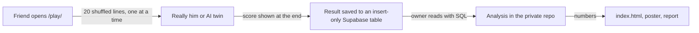

# Me or the Machine: project page

Public web page and live test for **Me or the Machine**, a Responsible AI final project (AIPI 590, Duke University, Fall 2026) by Jaideep Aher.

**Question:** if an AI writes one sentence in my voice, can the people closest to me tell it is not me?

**Result so far:** ten people who know me were right on 111 of 250 judgments (44%), no better than a coin flip.

| Link | What it is |
|---|---|
| https://jaideep-aher.github.io/me-or-the-machine-site/ | Project page: goal, threat model, results |
| https://jaideep-aher.github.io/me-or-the-machine-site/play/ | The 20-line blind test (set D) |
| [`report.pdf`](report.pdf) | Full report |
| [`poster_24x24.pdf`](poster_24x24.pdf) | 24 by 24 inch poster |

Why this picture: what happens when a friend takes the test and where their answers go.

## Files

| Path | What it is |
|---|---|
| `index.html` | The project page (static HTML, no build step) |
| `play/index.html` | The test; posts each finished round to Supabase with a publishable key that can only insert, never read |
| `report.pdf`, `poster_24x24.pdf` | Built from sources in the private repository |
| `.nojekyll` | Serves files as they are on GitHub Pages |

## Source code and data

Code, the 95 test lines, anonymised results, the analysis script and the poster and report sources are in a private repository, `jaideep-aher/me-or-the-machine`, shared with the course instructors. That README explains each folder and how to rerun the analysis.

## Privacy

Every judge knew some lines were AI-written. No message was ever sent to anyone as me. Results are anonymised before analysis, and other people's speech in my recordings was never used.
